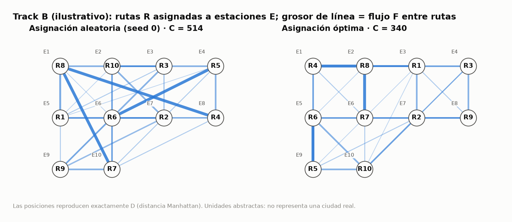
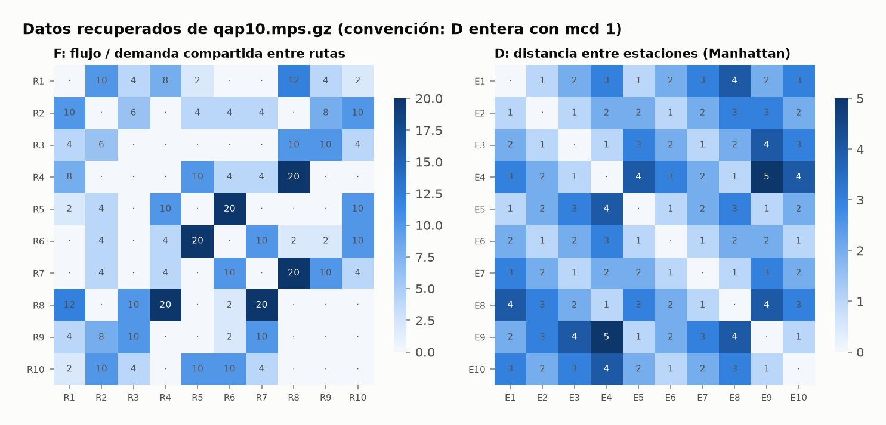
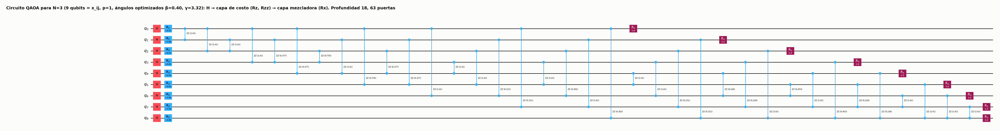
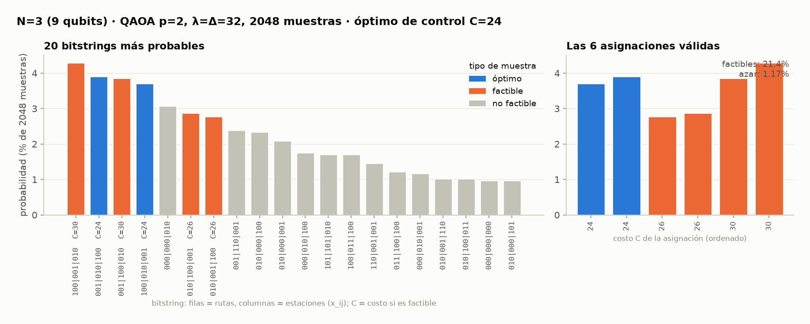
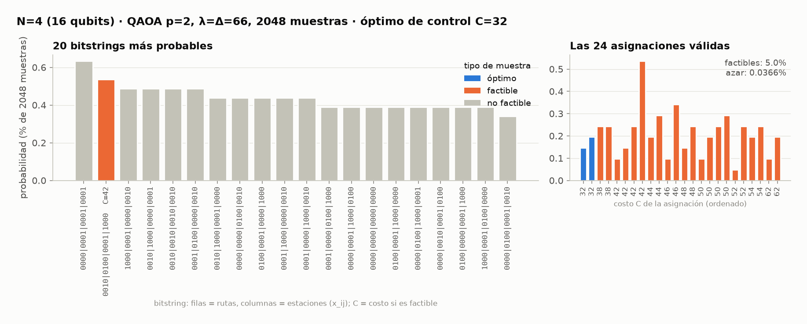
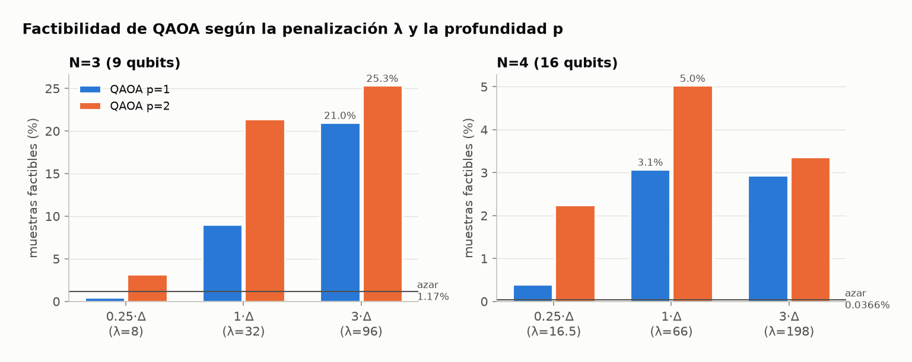
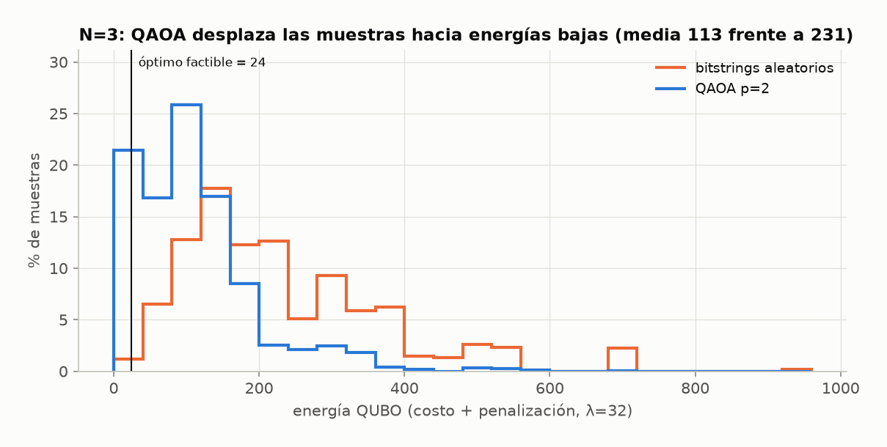
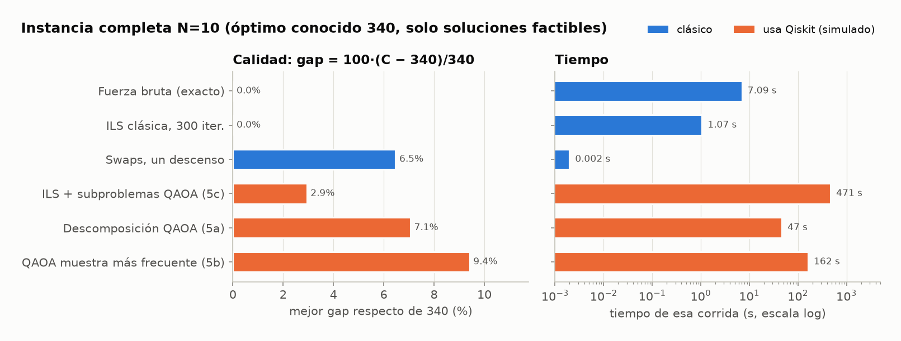

# ⚡ QAP10 · Recarga de flotas eléctricas con computación cuántica
**NTT DATA – IBM Quantum Hackathon 2026 · Reto QAP10 · Track B (Sostenibilidad y smart cities)**

Comparamos un método **clásico**, uno **cuántico** (QAOA con Qiskit) y uno **híbrido** para decidir qué estación de recarga atiende a cada una de 10 rutas eléctricas. Medimos honestamente qué funciona, qué no y por qué.

> 📓 ¿Prefieres verlo paso a paso con gráficas? Abre el notebook **[qap10_hackathon.ipynb](qap10_hackathon.ipynb)**.

---

## 🧭 Índice
1. [El resultado en 30 segundos](#-el-resultado-en-30-segundos)
2. [El problema, explicado sin fórmulas](#-1-el-problema-explicado-sin-fórmulas)
3. [Los datos: cómo los sacamos del archivo](#-2-los-datos-cómo-los-sacamos-del-archivo)
4. [El método clásico](#-3-el-método-clásico)
5. [El método cuántico: QUBO → Ising → QAOA](#-4-el-método-cuántico-qubo--ising--qaoa)
6. [Resultados con N=3 y N=4](#-5-resultados-con-n3-y-n4)
7. [La instancia completa N=10: el método híbrido](#-6-la-instancia-completa-n10-el-método-híbrido)
8. [¿Por qué el cuántico pierde aquí?](#-7-por-qué-el-cuántico-pierde-aquí)
9. [Qué hace Qiskit y qué es clásico](#-8-qué-hace-qiskit-y-qué-es-clásico)
10. [Supuestos del Track B](#-9-supuestos-del-track-b)
11. [Guion para el jurado y preguntas probables](#-10-guion-para-el-jurado-y-preguntas-probables)
12. [Glosario](#-11-glosario)
13. [Cómo reproducirlo](#-12-cómo-reproducirlo)

---

## ⏱ El resultado en 30 segundos
| Pregunta | Respuesta |
|---|---|
| ¿Leímos bien los datos? | ✅ Sí. Reproducimos los tres óptimos de control del reto: **24** (N=3), **32** (N=4) y **340** (N=10). |
| ¿Qué logra el método clásico? | Encuentra la mejor solución exacta (**340**) probando las 3,6 millones de opciones en **7 segundos**. |
| ¿Funciona el método cuántico (QAOA)? | ✅ Sí, en problemas pequeños. Con 9 y 16 qubits encuentra la mejor solución y produce **entre 20 y 140 veces más respuestas válidas que el azar**. |
| ¿Le gana al clásico? | ❌ No. Es miles de veces más lento y, en esta escala, el clásico ya es perfecto. |
| ¿Y en el problema completo (N=10)? | El híbrido con QAOA llega a **350** (2,9 % peor que el óptimo). Un método clásico de búsqueda local llega a **340** en ~1 segundo. |
| ¿Entonces qué aprendimos? | **Por qué** pierde el cuántico aquí y qué tendría que cambiar para que ayude. Es justo lo que pide el reto: *“No se trata de demostrar una ventaja cuántica: se trata de medir qué funciona, qué no y por qué.”* |

---

## 🚌 1. El problema, explicado sin fórmulas
Imagina una ciudad con **10 rutas de buses eléctricos** y **10 estaciones de recarga**. Cada ruta debe recargar en **una** estación, y cada estación atiende a **una** ruta.

Algunas rutas están muy relacionadas: comparten demanda, pasajeros o movimientos de vehículos. Si dos rutas muy relacionadas terminan en estaciones lejanas, “pagamos” mucho por esa distancia. Si quedan en estaciones cercanas, pagamos poco.

**El objetivo:** repartir las rutas entre las estaciones para que **las rutas que más se relacionan queden cerca**.

Lo medimos con un número, el **costo**:

> **Costo = suma, para cada par de rutas, de (cuánto se relacionan) × (qué tan lejos quedan sus estaciones)**

En símbolos: **C(π) = Σ_{i<k} F_ik · D_{π(i) π(k)}**, donde:
- **F_ik** (*flujo*) indica cuánto se relacionan las rutas *i* y *k*;
- **D_jl** (*distancia*) es la distancia entre las estaciones *j* y *l*;
- **π** es la asignación: π(i) es la estación que recibe la ruta *i*;
- *i<k* significa que **cada par se cuenta una sola vez**, que es la convención del reto.

Este problema se llama **Problema de Asignación Cuadrática (QAP)**. Es famoso por ser difícil, porque cada decisión afecta a todas las demás. Con 10 rutas hay **10! = 3.628.800** formas de repartirlas.



**Cómo leer la imagen:** cada círculo es una estación (E) con la ruta (R) que le tocó. Las líneas unen rutas relacionadas, y cuanto más gruesa la línea, más se relacionan. A la izquierda, una asignación al azar: hay líneas gruesas y largas que cruzan el mapa (costo 514). A la derecha, la mejor asignación posible: las líneas gruesas son cortas (costo **340**). *Las posiciones reproducen exactamente las distancias del archivo; es un esquema, no una ciudad real.*

---

## 📂 2. Los datos: cómo los sacamos del archivo
El reto da el archivo **`qap10.mps.gz`** de la biblioteca pública [MIPLIB](https://miplib.zib.de/instance_details_qap10.html). Es nuestro **único dato**: no usamos datos de ninguna ciudad real ni datos inventados.

**El truco (explicado como a un niño):** el archivo no trae las tablas F y D, sino **las multiplicaciones ya hechas**, F × D, para cada combinación posible (4050 números). Es como recibir el resultado de muchas tablas de multiplicar sin que te digan qué números se multiplicaron. Pero notamos un patrón: para cada par de rutas, los resultados son siempre **la misma tabla D multiplicada por un número** (el flujo F de ese par). Así pudimos separar los dos factores.

**El detalle de la escala:** 6 × 4 da lo mismo que 12 × 2. De la misma forma, F y D solo se pueden recuperar salvo un factor común. Elegimos la convención más natural: **D con números enteros lo más pequeños posible**. Y apareció una sorpresa: D resultó ser **la distancia en una cuadrícula** (como contar cuadras en un plano), con valores de 1 a 5.



**¿Cómo sabemos que lo hicimos bien?** Con tres comprobaciones independientes (`python data.py`):
1. Nuestro cálculo del costo coincide con el del archivo original en 200 asignaciones al azar.
2. F × D reproduce exactamente los 4050 números del archivo.
3. Recuperamos los óptimos que da el reto: **24** con 3 rutas ✅, **32** con 4 ✅ y **340** con las 10 ✅.

<details>
<summary>🔎 Detalle técnico de la lectura del MPS</summary>

- `X001..X100` son las variables x_ij (ruta i → estación j), con índice 10·i + j + 1. Las filas `NX01..NX20` son "una estación por ruta" y "una ruta por estación".
- Hay 4050 variables `Y`, una por cada producto x_ij·x_kl con **i<k y j≠l** (45 pares de rutas × 90 pares de estaciones). Esto confirma que cada par se cuenta una sola vez.
- Cada `Y` aparece en filas de enlace `C..A..`, y cada fila contiene una única X con coeficiente −1. Las dos X distintas ligadas a una Y dicen qué producto representa.
- Coeficiente de Y en el objetivo = F_ik·D_jl. Para cada (i,k), la matriz sobre (j,l) es un múltiplo de D (rango 1): lo comprobamos en los 45 pares. 16 de los 45 pares tienen flujo 0.
</details>

---

## 🖥 3. El método clásico
### Fuerza bruta: probar todas las opciones
La idea más simple: **probar las 3.628.800 asignaciones, una por una, y quedarse con la más barata**. No hace falta guardarlas todas: se van generando y comparando sobre la marcha.

| Rutas (N) | Mejor costo | Opciones probadas | Tiempo | Mejor asignación (ruta → estación) |
|---|---|---|---|---|
| 3 | **24** | 6 | < 1 ms | R1→E1, R2→E2, R3→E3 |
| 4 | **32** | 24 | < 1 ms | R1→E2, R2→E3, R3→E4, R4→E1 |
| 10 | **340** | 3.628.800 | **7,1 s** | R1→E3, R2→E7, R3→E4, R4→E1, R5→E9, R6→E5, R7→E6, R8→E2, R9→E8, R10→E10 |

### Búsqueda local: mejorar poco a poco
Con 14 rutas habría 87 mil millones de opciones, y la fuerza bruta deja de servir. Por eso también probamos una estrategia más "humana":
- **Swaps (intercambios):** tomar dos rutas, intercambiar sus estaciones y quedarse con el cambio si baja el costo. Repetir hasta que ningún intercambio mejore. Es rapidísimo, pero puede quedarse "atascado" en una solución buena que no es la mejor (un *óptimo local*).
- **Búsqueda local iterada (ILS):** cuando se atasca, **"sacudir"** la solución (mover 4 rutas al azar) y volver a mejorar. Es como agitar una caja de canicas para que se acomoden mejor.

La ILS encuentra **340 en 10 de 10 intentos, en ~1 segundo cada uno**.

---

## ⚛ 4. El método cuántico: QUBO → Ising → QAOA
Un computador cuántico no entiende "asigna rutas a estaciones". Hay que **traducir** el problema en cuatro pasos.

### Paso 1 · Convertir decisiones en preguntas de sí o no (qubits)
Para cada par (ruta, estación) hacemos una pregunta: *¿la ruta i va a la estación j?* La respuesta es 1 (sí) o 0 (no). Con N rutas hay **N × N preguntas**, y cada una será un **qubit**:
- N=3 → 9 qubits;
- N=4 → 16 qubits;
- N=10 → 100 qubits.

### Paso 2 · Convertir las reglas en "multas" (QUBO)
Al computador cuántico no se le pueden dar reglas como "cada ruta exactamente una estación". Solo entiende **"minimiza este número"**. Así que convertimos cada regla rota en una **multa**:

> **Energía = Costo + λ × (número de reglas rotas, al cuadrado)**

Si una ruta queda sin estación, o dos rutas comparten estación, se suma una multa λ. A esta fórmula se le llama **QUBO**.

**¿De qué tamaño debe ser la multa λ?** Debe ser **mayor que lo que uno se ahorra haciendo trampa**. Si quitas una ruta del mapa, te ahorras como mucho Δ (lo que aportaba esa ruta: Δ=32 con N=3 y Δ=66 con N=4). Por eso elegimos **λ = Δ**. Para demostrarlo, probamos tres tamaños:

| Multa λ | Qué pasa | Analogía |
|---|---|---|
| **0,25·Δ** (pequeña) | Con N=3, la "mejor energía" corresponde a una solución **inválida** (energía 20 < 24). Sale más barato hacer trampa. | Una multa de estacionamiento de 1 €: todos estacionan mal. |
| **1·Δ** (justa) ✅ | La mejor energía es la mejor asignación real. | Una multa que duele lo justo. |
| **3·Δ** (enorme) | Sigue funcionando, pero el costo real pesa poco frente a las multas y el algoritmo se distrae evitándolas. | Si la multa es tan enorme que solo piensas en no recibirla, te olvidas de llegar rápido. |

### Paso 3 · Traducir al idioma de los qubits (Ising)
Con la sustitución x = (1 − Z)/2, el QUBO se convierte en un **Hamiltoniano de Ising**: una suma de términos con operadores Z de los qubits. En Qiskit es un objeto `SparsePauliOp` (45 términos para N=3 y 112 para N=4). Es la "receta de energía" que el circuito cuántico va a minimizar.

### Paso 4 · QAOA: un circuito con perillas
**QAOA** (*Quantum Approximate Optimization Algorithm*) es un circuito cuántico con **perillas** (los ángulos γ y β):
1. **Empezar con todas las respuestas a la vez:** las puertas H ponen los qubits en una superposición de las 2⁹ = 512 combinaciones posibles.
2. **Capa de costo (γ):** las puertas Rz y Rzz "marcan" cada combinación según su energía.
3. **Capa mezcladora (β):** las puertas Rx mezclan las combinaciones, de modo que las de baja energía se vuelven más probables.
4. **Medir:** cada medición devuelve **una** combinación de 0 y 1. Repetimos 2048 veces (*shots*).

**¿Quién gira las perillas?** Un optimizador **clásico** (COBYLA). Prueba unos ángulos, simula el circuito, mira la energía promedio y ajusta los ángulos. Es como afinar una radio: giras hasta que suena bien. **p** es el número de capas: p=1 es una capa de costo más una mezcladora, y p=2 son dos de cada.

> 🎲 **Analogía Feynman:** QAOA es como **un dado cargado** que vamos ajustando. Al principio todas las caras (combinaciones) salen igual de seguido. Girando las perillas cargamos el dado para que salgan más a menudo las caras "baratas". Nunca sabemos de antemano qué cara saldrá, pero sí qué caras salen más.



*El circuito real que simulamos para N=3: 9 qubits, puertas H (rojo), capa de costo Rz/Rzz (azul) y mezcladora Rx (morado).*

---

## 📊 5. Resultados con N=3 y N=4
Usamos un simulador cuántico exacto de Qiskit (`qiskit_aer`), sin ruido. Cada configuración se midió **2048 veces**.

### ¿Qué respuestas da QAOA? (histogramas)


**N=3 (9 qubits):** las 4 respuestas más probables son todas **válidas**, y 2 de ellas son **la óptima** (azul, costo 24). En total, el **21,4 %** de las mediciones son válidas, frente al **1,2 %** si eligiéramos al azar.



**N=4 (16 qubits):** el problema se complica. Solo 24 de las 65.536 combinaciones son válidas (0,04 %). QAOA sube eso al **5 %**, unas 140 veces más, y encuentra el óptimo (32). Pero el panel derecho muestra una limitación honesta: **entre las respuestas válidas, QAOA no prefiere claramente la óptima**. La más frecuente cuesta 42. Con p=2, el "dado" está poco cargado.

### ¿Qué multa y cuántas capas funcionan mejor?


- **Más capas (p=2) siempre ayuda**, pero tarda unas 4 veces más.
- **Con multa pequeña (0,25·Δ), QAOA puede ser peor que el azar** (N=3, p=1: 0,5 % frente a 1,2 %). No es un fallo de QAOA: minimiza bien la energía, pero con esa multa la energía mínima es una solución inválida.
- **Con N=4, una multa enorme (3·Δ) empeora** respecto de la justa (λ=Δ).

### La energía no es el costo


QAOA desplaza las mediciones hacia energías bajas (promedio **113** frente a **231** del azar). Pero ojo: **la energía incluye las multas, el costo no**. Una solución inválida puede tener poca energía (por ejemplo, 20) sin ser una asignación real. Por eso **siempre reportamos por separado la energía QUBO y el costo de las soluciones válidas**.

### Tabla resumen (2048 mediciones por fila)
| N | Método | % válidas | % óptimas | Mejor costo válido | Tiempo |
|---|---|---|---|---|---|
| 3 | Fuerza bruta | 100 | – | **24** | < 1 ms |
| 3 | Permutaciones al azar (clásico) | 100 | 34,1 | 24 | 0,05 s |
| 3 | Combinaciones de bits al azar | 0,8 – 1,2 | 0,2 – 0,3 | 24 | ~0,5 s |
| 3 | **QAOA** (λ=3Δ, p=2), la mejor | **25,3** | **7,9** | 24 | 6,7 s |
| 4 | Fuerza bruta | 100 | – | **32** | < 1 ms |
| 4 | Permutaciones al azar (clásico) | 100 | 8,4 | 32 | 0,08 s |
| 4 | Combinaciones de bits al azar | 0 – 0,1 | 0 | 52, o ninguna válida | ~2 s |
| 4 | **QAOA** (λ=Δ, p=2), la mejor | **5,0** | 0,3 | 32 | 25 s |

Tabla completa con las 12 configuraciones de QAOA: [results/comparison_N3_N4.md](results/comparison_N3_N4.md).

> ⚠️ **Lectura honesta:** el "mejor costo válido" siempre sale óptimo porque con 6 o 24 opciones basta encontrar unas pocas válidas. Lo que de verdad distingue los métodos es **el % de respuestas válidas y óptimas**.

---

## 🧩 6. La instancia completa N=10: el método híbrido
**El obstáculo:** con 10 rutas harían falta **100 qubits**. Simular 100 qubits requiere guardar 2¹⁰⁰ números (unos 2·10³¹ bytes), más memoria que todos los computadores del mundo juntos.

**La idea: divide y vencerás.** Partimos de una asignación al azar y repetimos lo siguiente:
1. **Congelar 7 rutas** y dejar **libres 3** (o 4).
2. Las rutas libres solo pueden intercambiar las estaciones que ya ocupan. Ese mini-problema tiene **9 qubits** (o 16), algo que sí cabe en el simulador.
3. **QAOA** propone cómo reordenarlas.
4. Si el costo total baja, aceptamos el cambio.

Es como ordenar un armario grande **un cajón a la vez**.

**Para medir si QAOA aporta algo, comparamos con el mismo procedimiento usando un "solucionador clásico exacto"**, que prueba las 6 o 24 opciones del mini-problema. Así aislamos el efecto de la parte cuántica.



### Lo que encontramos
| Experimento | Qué hicimos | Resultado |
|---|---|---|
| **5a** · Divide y vencerás | 30 mini-problemas de 3 rutas o 20 de 4, más un pulido final con swaps | QAOA tomó **exactamente las mismas decisiones** que el solucionador exacto en las 6 pruebas, pero tardó **50–230 s frente a 0,01 s**. Mejor resultado: **364** (7,1 %). |
| **5b** · QAOA "sin ayuda" | Tomar solo la respuesta más frecuente de QAOA, sin filtrar | Esa respuesta es válida en el **~78 %** de los casos. Cuando no lo es, la **reparamos** (ver abajo). Resultado peor: **372** (9,4 %). Buena parte de la calidad viene de **medir muchas veces y filtrar clásicamente**. |
| **5c** · Búsqueda local + QAOA | Sacudir y mejorar (ILS), añadiendo mini-problemas QAOA | **QAOA resolvió 319 mini-problemas y ninguno mejoró la solución.** Los tres métodos (con QAOA, con el solucionador exacto y sin mini-problemas) dieron **resultados idénticos**: 350 / 362 / 350. |
| **5d** · Solo clásico | ILS con 300 sacudidas, 10 intentos | **340 (el óptimo) en 10 de 10** intentos, ~1,2 s cada uno. |

**Ejemplos de reparación (5b), antes y después:**
| Rutas libres | Antes: respuesta de QAOA | Después de reparar | ¿Se aceptó? |
|---|---|---|---|
| R2, R4, R5 | inválida (energía QUBO 592) | válida, costo 422 | ✅ sí (mejoraba 430) |
| R4, R8, R9 | inválida (energía QUBO 1074) | válida, costo 450 | ❌ no |
| R1, R4, R10 | inválida (energía QUBO 1314) | válida, costo 422 | ❌ no |

*Reparar significa elegir la asignación válida que más se parece a la respuesta de QAOA, sin mirar el costo, para no hacer trampa escondiendo un solucionador clásico dentro de la reparación.*

> 🔬 **Una lección de rigor:** en una primera versión, el método con mini-problemas **parecía mejor** que el clásico. Al revisarlo descubrimos que la diferencia venía solo de cómo se repartían los números aleatorios entre las variantes, no de los mini-problemas. Al darles a todas las mismas "sacudidas", la ventaja desapareció. Lo dejamos documentado porque **medir bien vale más que un resultado bonito**.

Tablas detalladas: [5a](results/n10_hybrid.md) · [5b](results/n10_top.md) · [5c](results/n10_ils.md) · [5d](results/n10_ils_long.md).

---

## 🤔 7. ¿Por qué el cuántico pierde aquí?
**1. Busca en un espacio gigante lleno de respuestas inválidas.** Con 4 rutas hay 65.536 combinaciones de bits, pero **solo 24 son asignaciones válidas** (0,04 %). QAOA gasta casi todo su esfuerzo en aprender las reglas. El método clásico, en cambio, solo genera asignaciones válidas desde el principio. *Es como buscar una palabra en un diccionario de letras al azar, en vez de en un diccionario de palabras reales.*

**2. Pocas capas (p=1 o 2).** QAOA solo garantiza encontrar la mejor respuesta con muchísimas capas. Con 1 o 2, el dado está poco cargado.

**3. La multa λ es delicada.** Si es pequeña, hacer trampa sale barato. Si es grande, el costo real deja de importar.

**4. Simular es caro.** Cada giro de perilla obliga a simular el circuito completo en un computador normal (100–550 veces por mini-problema). Probar las 24 opciones directamente es ~10.000 veces más rápido.

**5. En N=10, el cuello de botella no es el mini-problema.** Reordenar 3 rutas casi nunca mejora una solución que ya pasó por intercambios. Lo que importa es la estrategia global, que es clásica.

### ¿Cuándo podría ayudar la computación cuántica?
- Con **hardware real** que mida miles de veces por segundo, sin el costo de simular.
- Con **mini-problemas más grandes y mejor elegidos** (por ejemplo, rutas muy conectadas entre sí), donde probar todas las opciones clásicamente ya no sea trivial.
- Con **formulaciones que respeten las reglas por diseño** (mezcladores que solo exploran asignaciones válidas), en vez de multas.

### Escalamiento (de cara a N ≥ 14)
| N | Qubits del QUBO completo | Asignaciones válidas | Memoria para simular |
|---|---|---|---|
| 4 | 16 | 24 | 1 MiB |
| 5 | 25 | 120 | 512 MiB |
| 10 | 100 | 3.628.800 | ≈ 2·10³¹ B |
| 14 | 196 | 87.178.291.200 | ≈ 1,6·10⁶⁰ B |

Nuestro método híbrido **sí escala en memoria**, porque cada mini-problema sigue teniendo 9 o 16 qubits. Pero el número de mini-problemas posibles crece rápido, y cada uno cuesta segundos de simulación.

---

## 🔧 8. Qué hace Qiskit y qué es clásico
| Etapa | Herramienta | ¿Cuántico o clásico? |
|---|---|---|
| Leer el archivo, recuperar F y D, validar | numpy | 🖥 clásico |
| Modelo → QUBO (multas λ) → Ising | `qiskit_optimization` | ⚛ Qiskit (modelado) |
| Construir el circuito QAOA | `qiskit.circuit.library.QAOAAnsatz` | ⚛ Qiskit |
| Calcular la energía del circuito | `qiskit_aer` EstimatorV2 | ⚛ Qiskit (simulación) |
| Girar las perillas γ, β | `scipy` COBYLA | 🖥 clásico |
| Medir el circuito 2048 veces | `qiskit_aer` SamplerV2 | ⚛ Qiskit (simulación) |
| Revisar validez, calcular costo, reparar | numpy | 🖥 clásico |
| Fuerza bruta, swaps, ILS, elegir mini-problemas | Python | 🖥 clásico |

> **Importante:** todo lo cuántico se **simuló** en un computador normal, con el simulador oficial de Qiskit. No usamos hardware cuántico real ni hizo falta una cuenta de IBM. El reto lo permite: pide usar Qiskit para *"construir, representar, **simular** o evaluar"*.

---

## 🌱 9. Supuestos del Track B
- **F** se interpreta como un *indicador* de demanda compartida entre rutas, y **D** como la distancia entre estaciones. Ambos vienen de un **benchmark matemático**, no de una ciudad real.
- Los costos están en **unidades abstractas** (flujo × distancia).
- **No afirmamos reducciones de emisiones, de energía ni de tiempos de operación.** El reto lo dice claramente: solo podrían afirmarse *"si se incorporan datos y supuestos adicionales que los respalden"* (consumo por km, demanda real, topología de la ciudad…).
- Lo que sí podemos decir: **en este modelo, la mejor asignación reduce el costo flujo × distancia de 514 (al azar) a 340, un 34 % menos**. Traducir eso a kWh o CO₂ requeriría esos datos adicionales.

---

## 🎤 10. Guion para el jurado y preguntas probables
### Guion sugerido (5 minutos)
1. **El problema (45 s):** 10 rutas eléctricas, 10 estaciones; las rutas relacionadas deben quedar cerca. → *Imagen del esquema.*
2. **Los datos (45 s):** el archivo traía multiplicaciones hechas; separamos F y D y lo validamos con 24, 32 y 340. → *Imagen de las matrices.*
3. **Clásico (30 s):** la fuerza bruta da el óptimo 340 en 7 s. Es nuestra regla para medir.
4. **Cuántico (90 s):** preguntas sí/no → multas (λ) → Ising → QAOA, el dado cargado. → *Circuito e histograma N=3.*
5. **Resultados (60 s):** QAOA da entre 20 y 140 veces más respuestas válidas que el azar, pero pierde frente al clásico. → *Gráfica de λ y p.*
6. **N=10 y conclusión (45 s):** divide y vencerás; QAOA iguala al solucionador exacto pero no aporta mejoras; explicamos por qué y cuándo podría ayudar. → *Gráfica N=10.*

### Preguntas que probablemente harán
<details><summary><b>¿Por qué usaron simulador y no hardware real?</b></summary>
El reto permite simular. Además, el simulador sin ruido muestra el <i>mejor caso</i> de QAOA: si ni así gana, el hardware real con ruido tampoco ganaría hoy. Correr N=3 en hardware IBM sería un buen siguiente paso para medir el efecto del ruido.
</details>

<details><summary><b>¿Cómo eligieron λ?</b></summary>
λ debe ser mayor que el máximo ahorro posible por romper una regla (Δ = la mayor contribución de una ruta al costo). Lo comprobamos de forma exacta: con 0,25·Δ, la energía mínima de N=3 es una solución inválida; con Δ y 3·Δ, es la óptima.
</details>

<details><summary><b>¿Por qué no resolvieron N=10 directamente con QAOA?</b></summary>
Serían 100 qubits: simularlos necesita 2¹⁰⁰ amplitudes (≈ 2·10³¹ bytes). Por eso usamos mini-problemas de 9 o 16 qubits dentro de una estrategia híbrida.
</details>

<details><summary><b>¿Usaron el óptimo 340 para hacer trampa?</b></summary>
No. Todas las búsquedas empiezan con asignaciones al azar y paran por un presupuesto fijo. El 340 solo se usa para calcular el gap.
</details>

<details><summary><b>¿Entonces la computación cuántica no sirve?</b></summary>
Sirve para formular y explorar el problema, y concentra la probabilidad en buenas respuestas. Pero a esta escala el clásico es imbatible. Para que ayude haría falta hardware más rápido, mini-problemas más grandes o formulaciones que respeten las reglas por diseño.
</details>

<details><summary><b>¿Qué diferencia hay entre energía y costo?</b></summary>
La energía incluye las multas por romper reglas. El costo solo existe para asignaciones válidas. Una respuesta inválida puede tener poca energía sin ser útil, por eso las reportamos por separado.
</details>

<details><summary><b>¿Es reproducible?</b></summary>
Sí. Las semillas están fijadas (QAOA 42, experimentos 0–9), las versiones exactas en <code>requirements.txt</code> y los parámetros en <code>results/environment.json</code>. Ejecutar QAOA dos veces da exactamente los mismos ángulos y mediciones.
</details>

---

## 📖 11. Glosario
| Término | En palabras simples |
|---|---|
| **QAP** | Problema de asignación cuadrática: repartir N cosas en N lugares considerando cómo interactúan entre sí. |
| **Qubit** | Bit cuántico. Aquí, cada qubit responde "¿la ruta i va a la estación j?". |
| **QUBO** | Escribir el problema como "minimiza una suma de productos de variables 0/1", con las reglas convertidas en multas. |
| **λ (lambda)** | El tamaño de la multa por romper una regla. |
| **Ising / Hamiltoniano** | El mismo QUBO escrito en el idioma de los qubits (operadores Z). |
| **QAOA** | Algoritmo cuántico con perillas (γ, β) que, bien afinadas, hacen más probables las respuestas baratas. |
| **p** | Número de capas de QAOA. Más capas, más precisión y más tiempo. |
| **Shots** | Número de veces que medimos el circuito (2048). |
| **Factible / válida** | Una asignación que cumple todas las reglas (una estación por ruta y una ruta por estación). |
| **Gap** | Qué tan lejos estamos del óptimo: 100·(C − 340)/340 %. |
| **Swap** | Intercambiar las estaciones de dos rutas. |
| **ILS** | Búsqueda local iterada: mejorar con swaps, sacudir y repetir. |
| **Híbrido** | Combinar partes cuánticas (QAOA en mini-problemas) con partes clásicas (estrategia global). |

---

## 🛠 12. Cómo reproducirlo
```bash
git clone <este-repositorio> && cd <carpeta>
python -m venv .venv
.venv\Scripts\activate                # Windows  (Linux/Mac: source .venv/bin/activate)
pip install -r requirements.txt

python data.py                        # valida F, D y los óptimos 24 / 32 / 340      (~6 s)
python classical.py                   # fuerza bruta N=3, 4, 10                       (~7 s)
python qiskit_qaoa.py                 # QAOA N=3, 4 con 3 valores de λ y p=1,2        (~2,5 min)
python experiments.py                 # tabla N=3/4 frente al azar
python experiments.py --n10a          # 5a divide y vencerás N=10                     (~14 min)
python experiments.py --n10b          # 5b QAOA sin filtrar + reparación              (~8 min)
python experiments.py --n10c          # 5c búsqueda local + QAOA (ablación)           (~25 min)
python experiments.py --n10d          # 5d búsqueda local clásica, 10 intentos        (~15 s)
python plots.py                       # regenera todas las figuras de figures/        (~1 min)
jupyter lab qap10_hackathon.ipynb     # recorrido guiado con gráficas
```

### Estructura del repositorio
| Archivo | Qué contiene |
|---|---|
| [data.py](data.py) | Lectura del archivo MPS, recuperación de F y D, función de costo, validación |
| [classical.py](classical.py) | Fuerza bruta, swaps, solucionador exacto de mini-problemas, sacudidas |
| [qiskit_qaoa.py](qiskit_qaoa.py) | Modelo → QUBO → Ising → QAOA; mini-problemas para N=10 |
| [experiments.py](experiments.py) | Comparaciones, experimentos N=10 y registro del entorno |
| [plots.py](plots.py) | Todas las figuras (matplotlib) |
| [qap10_hackathon.ipynb](qap10_hackathon.ipynb) | Notebook paso a paso, ya ejecutado |
| [results/](results/) | Resultados en JSON, CSV y Markdown |
| [figures/](figures/) | Imágenes del README |
| [data/qap10.mps.gz](data/qap10.mps.gz) | Datos originales de MIPLIB |

### Reproducibilidad
- **Semillas:** QAOA y transpilación 42; comparaciones con el azar 42; experimentos N=10 con semillas 0–2 (5a, 5b, 5c) y 0–9 (5d). Los mini-problemas de 5c usan una semilla aparte (10000 + semilla).
- **Determinismo comprobado:** ejecutar QAOA dos veces da los mismos ángulos y las mismas mediciones.
- **Versiones:** Python 3.13.3, qiskit 2.6.1, qiskit-aer 0.18.0, qiskit-optimization 0.7.0, numpy 2.5.4, scipy 1.18.1. Lista completa en [requirements.txt](requirements.txt) y parámetros en [results/environment.json](results/environment.json).
- **Configuración de QAOA:** COBYLA (máximo 200 iteraciones, 3 arranques), 2048 shots, Hamiltoniano normalizado por su coeficiente máximo, transpilado a {h, rx, rz, rzz, cx}, simulación statevector exacta con Aer.
- **Equipo usado:** portátil con Windows 11 y CPU. Todos los tiempos son de simulación clásica.
